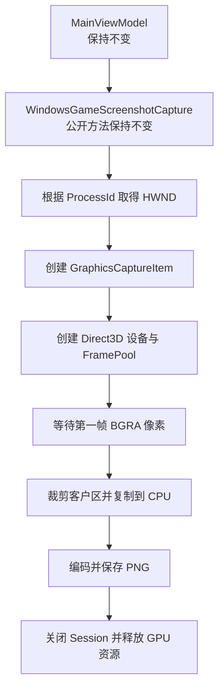

# 截图功能讲解

## WGC (Windows Graphics Capture)

### WGC是什么

WGC 是微软从 **Windows 10 1803** 开始提供的现代窗口捕获 API，属于 `Windows.Graphics.Capture`。核心由三个对象组成：

- `GraphicsCaptureItem`：指定要捕获的窗口或显示器；
- `Direct3D11CaptureFramePool`：接收 D3D11 纹理帧的帧池；
- `GraphicsCaptureSession`：启动和停止捕获会话。


### 为什么能解决窗口遮挡问题

Windows 的桌面窗口并不是直接互相画在屏幕上的。DWM 会先让每个顶层窗口绘制到自己的**离屏表面**，再按照 Z 序把这些表面合成为最终桌面。

- `ScreenDC`、`GDI` 的屏幕截图：读取的是**合成后的桌面**，所以窗口 B 压在窗口 A 上时，截到的就是“A 加 B”。
- `DXGI_DesktopDup`：读取的同样是**合成后的整块显示器输出**，遮挡关系已经存在。
- **WGC**：通过窗口句柄获得 `GraphicsCaptureItem`，取的是**窗口 A 自己的合成表面**，此时窗口 B 还没有被叠加进去。

所以 WGC 不需要把窗口置顶，也不需要移开其他窗口。遮挡是在 DWM 最后合成桌面时才发生的，而 WGC 取的是合成前的窗口内容


### 为什么能在后台截图

这里的“后台”指的是：

- 窗口不是前台活动窗口；
- 窗口被其他窗口盖住；
- 不需要窗口获得焦点或被激活。

WGC 能这样做，是因为它建立的是**一条独立的窗口帧订阅通道**：

text

```text
目标窗口 → DWM 窗口表面 → FramePool（D3D11 纹理）→ 应用
```

这条通道不依赖屏幕最终显示什么，也不需要像 `PrintWindow` 那样要求目标程序响应 `WM_PRINT` 重绘。只要 DWM 仍在更新这个窗口，WGC 就能持续收到帧。





